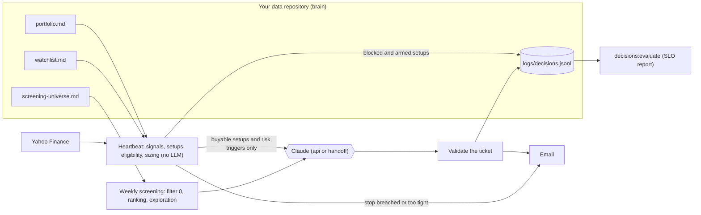

# Finance Agent

A swing-trading assistant for a small personal portfolio. It runs cheap technical filters in code
several times a day, escalates to Claude only when a signal fires, and emails a proposal with its
ticket already computed. **It never places orders**: you decide and execute at your broker.

> [!WARNING]
> **Not financial advice.** This is a personal project shared as-is under the MIT license. It
> makes mistakes, its rules are calibrated on small samples, and any trade you make with it is
> your decision and your risk. Market data comes from Yahoo Finance's unofficial API by default:
> you are responsible for respecting [Yahoo's terms of use](https://legal.yahoo.com/us/en/yahoo/terms/otos/index.html).

## At a glance

- **What it does**:
  - Watches your positions and watchlist in two currency silos (EUR, USD).
  - Detects entry setups (pullbacks and breakouts).
  - Blocks the ones that fail deterministic rules.
  - Sizes every ticket by risk, and asks Claude only about what is actually buyable or at risk.
  - Ranks a weekly screening, briefs you on Mondays, and records every decision, including the ones not to act, so it can measure itself against simply holding a benchmark ETF.
- **Where state lives**: Markdown files in a data directory you own (the _brain_), read in any notes app and versioned in git ([ADR-0003](docs/decisions/0003-state-as-versioned-markdown.md)).
- **Run it in one command**, with no keys and no network:

  ```bash
  npm ci && npm run demo -- --currency EUR
  ```

- **SLO**: the quality of its proposals against what actually happened, executed or not, with confidence bounds ([SLO](#slo)). Operational cost: at most one Claude call per escalated signal.
- **Terms** such as R, plan R, silo or setup are defined in the [glossary](docs/glossary.md).
- **Quality**: an offline unit and component test suite (`npm test`), line coverage ≥ 80% enforced in CI (97.4% measured), type-checked lint, CodeQL, Dependabot, dependency audit, and a pre-push hook that runs the same checks ([Quality gates](#quality-gates)).

## Requirements

- Node.js ≥ 22 (`.nvmrc`) and npm.
- To run it for real:
  - an [Anthropic API key](https://console.anthropic.com/), or Claude Code for [handoff mode](#api-runner-github-actions);
  - an SMTP account (for example Gmail with an app password);
  - a GitHub repository for your data, if you want it scheduled.

## Quick start

```bash
npm ci
npm test
npm run demo -- --currency EUR   # or USD
```

The demo runs one heartbeat against the example brain in [`examples/brain/`](examples/brain): a
fictitious portfolio, watchlist, two theses, policy and universe. Prices are synthetic, from
[`examples/market/`](examples/market). It works on a temporary copy, does not call Claude (the
escalations stay in `logs/pending/`) and sends no email: it prints it.

- In EUR it shows a position close to its stop being escalated and an armed breakout with its Buy Stop.
- In USD it shows an armed breakout.

`npx tsx examples/market/generate.ts` regenerates the prices.

## Configuration, step by step

Every variable is documented in [`.env.example`](.env.example). Copy it to `.env` for local runs.
In GitHub Actions they come from repository variables and secrets.

1. **Data directory.** Copy [`examples/brain/`](examples/brain) to your own repository and set `VAULT_PROJECT_DIR` to it. Fill in:
   - `portfolio.md`, which you keep in sync with your broker by hand;
   - `watchlist.md`, `screening-universe.md` and the theses.

   The format is a versioned contract: [`docs/input-format.md`](docs/input-format.md).

2. **Benchmarks.** Set `REFERENCE_TICKER_EUR` and `REFERENCE_TICKER_USD` to one **accumulating** ETF per silo, for example a STOXX Europe 600 and an S&P 500 UCITS ETF. They drive the shadow portfolio, the market regime and relative strength ([ADR-0009](docs/decisions/0009-swing-framework-risk-sizing-and-measurement.md)).
3. **Reasoner.**
   - `ANALYST_PROVIDER=api` with `ANTHROPIC_API_KEY`;
   - or `handoff`, to leave the reasoning to a Claude Code session ([below](#reasoner-api-or-handoff)).
4. **Email.**
   - `SMTP_HOST`, `SMTP_PORT`, `SMTP_USER`, `SMTP_PASS` and `ALERT_EMAIL_TO`. Without them, a local run prints emails to the log; the reusable workflows fail instead, so a lost alert never goes unnoticed.
   - To run without email, set `MAIL_TRANSPORT=none`: nothing is sent and the run passes. In the reusable workflows, pass `email: false` (default `true`) and omit `smtp-user`, `alert-email-to` and `SMTP_PASS`. With email on and no SMTP settings, every entry point fails at startup. In `email-relay.yml`, `email: false` also skips the screening summary: queued alerts and a pending screening run stay untouched and are not re-sent later.
   - From an environment that can't open SMTP, use `MAIL_TRANSPORT=outbox` and run the relay ([ADR-0005](docs/decisions/0005-email-outbox-and-relay.md)).
5. **Output language.** `OUTPUT_LANGUAGE=en` (default) or `es` for emails, reports and notes. The input format stays in English.
6. **Broker parameters.** The engine integrates with no broker. Tell it what yours allows and charges:
   - `BROKER_FRACTIONAL_SHARES`;
   - `BROKER_MIN_ORDER_VALUE`;
   - `BROKER_FX_CONVERSION_PCT`.
7. **Check connectivity.** `npm run smoke-test` checks Yahoo Finance and, if a key is set, Anthropic, without touching your data or sending email.

### Scheduling from your data repository

Your data repository calls this repository's reusable workflows, pinned to a tag
([ADR-0001](docs/decisions/0001-public-engine-private-data.md)). They run the engine with
read-only permission and return the changes as a patch. Your workflow applies the patch and
commits it:

```yaml
name: Finance Agent — heartbeat
on:
  schedule:
    - cron: "0 17 * * 1-5" # after the European close
permissions: {}
jobs:
  heartbeat:
    permissions:
      contents: read
    uses: alvaromongon/finance-agent/.github/workflows/heartbeat.yml@v0.1.0
    with:
      currency: EUR
      data-path: finance-agent # where your brain lives in this repo
      engine-repository: alvaromongon/finance-agent
      engine-ref: v0.1.0
      output-language: en
      reference-ticker-eur: ${{ vars.REFERENCE_TICKER_EUR }}
      reference-ticker-usd: ${{ vars.REFERENCE_TICKER_USD }}
      smtp-user: ${{ vars.SMTP_USER }}
      alert-email-to: ${{ vars.ALERT_EMAIL_TO }}
    secrets:
      ANTHROPIC_API_KEY: ${{ secrets.ANTHROPIC_API_KEY }}
      SMTP_PASS: ${{ secrets.SMTP_PASS }}
  commit:
    needs: heartbeat
    runs-on: ubuntu-latest
    permissions:
      contents: write
    steps:
      - uses: actions/checkout@v7
      - uses: alvaromongon/finance-agent/.github/actions/commit-changes@v0.1.0
        with:
          artifact: ${{ needs.heartbeat.outputs.changes-artifact }}
          paths: finance-agent/logs/ finance-agent/portfolio.md
          message: "chore(logs): heartbeat EUR"
```

The other flows follow the same pattern; their complete callers are in
[`examples/workflows/`](examples/workflows) ([below](#api-runner-github-actions)).
Upgrading the engine means changing the tag.

### Reasoner: API or handoff

#### API runner: GitHub Actions

The API runner is one way to run the flows, the one the reusable workflows implement: the engine
calls the Anthropic API itself, on a schedule. Copy the callers you need from
[`examples/workflows/`](examples/workflows) to `.github/workflows/` in your data repository, set
`data-path` to where your brain lives, and add the repository variables and secrets of
[Configuration](#configuration-step-by-step). Each one is pinned to a release tag and has a
`commit` job that applies the run's patch and commits only the paths that flow writes. Other
runners are possible, for example Claude Code routines with `handoff` (below).

| Example                                                                   | Triggers                                                                           | Commits                                               |
| ------------------------------------------------------------------------- | ---------------------------------------------------------------------------------- | ----------------------------------------------------- |
| [`heartbeat-eu.yml`](examples/workflows/heartbeat-eu.yml)                 | Weekdays 17:00 UTC                                                                 | `logs/`, `portfolio.md`                               |
| [`heartbeat-us.yml`](examples/workflows/heartbeat-us.yml)                 | Weekdays 22:30 UTC                                                                 | `logs/`, `portfolio.md`                               |
| [`heartbeat-eu-handoff.yml`](examples/workflows/heartbeat-eu-handoff.yml) | Weekdays 17:00 UTC, then wakes a routine (handoff runner)                          | `logs/`, `portfolio.md`                               |
| [`monday-briefing.yml`](examples/workflows/monday-briefing.yml)           | Mondays 06:00 UTC                                                                  | `logs/`, `portfolio.md`, `watchlist.md`, `tesis/`     |
| [`screening.yml`](examples/workflows/screening.yml)                       | Saturdays 08:00 UTC                                                                | `logs/`, `tesis/`, `watchlist.md`, `screening-log.md` |
| [`email-relay.yml`](examples/workflows/email-relay.yml)                   | Push to `logs/outbox/**` or the screening `results.jsonl`, hourly fallback, manual | `logs/`                                               |

The relay is only needed for runners that use `MAIL_TRANSPORT=outbox` (they can't open SMTP); do
not install it in API mode, where the other flows send their own emails. Its hourly cron costs
runner minutes even when the outbox is empty, and if `outbox:send` fails after sending some files,
they are sent again the next hour. It runs one at a time (`concurrency`) and also polls hourly,
because a push made with the default `GITHUB_TOKEN` does not trigger workflows. To run without
email, see _Email_ above; the `email` input needs a release newer than `v0.1.0`, so the examples
carry it commented out.

#### Handoff

With `ANALYST_PROVIDER=handoff`, the engine writes each escalation and its prompts to
`logs/pending/` instead of calling the API. A Claude Code session, for example a scheduled
routine, then reasons over them through deterministic commands that validate its answer before
recording anything ([ADR-0004](docs/decisions/0004-handoff-mode-for-the-reasoner.md)):

| Flow                  | Commands                                                        |
| --------------------- | --------------------------------------------------------------- |
| Heartbeat escalations | `pending:list`, `pending:show`, `pending:resolve`               |
| Monday briefing       | `monday-briefing:prepare`, `monday-briefing:finalize`           |
| Weekly screening      | `screening:prepare`, `screening:resolve`, `screening:summarize` |

The system prompts live in your brain, under `routines/`.

One runner for this mode is scheduled Claude Code routines: the orchestration prompts, the routine
environment (variables, network allowlist, engine pinned by a SessionStart hook), how the heartbeat
wakes the routine and the email relay it requires are in
[Runner: handoff with Claude Code routines](docs/routine-runner.md). It is an example; other runners
are possible.

## Commands

| Command                                 | What it does                                          |
| --------------------------------------- | ----------------------------------------------------- |
| `npm run demo -- --currency EUR\|USD`   | One heartbeat against the example brain, offline      |
| `npm run heartbeat:eu` / `heartbeat:us` | One heartbeat for a silo                              |
| `npm run weekly-screening`              | Weekly screening (API mode)                           |
| `npm run monday-briefing`               | Monday briefing (API mode)                            |
| `npm run decisions:evaluate`            | Writes `logs/decisions-evaluation.md`: the SLO report |
| `npm run decisions:chart`               | Writes `logs/decisions-evaluation.svg`: SLI 1 chart   |
| `npm run decision:record`               | Records a trade or cash flow you made (JSON on stdin) |
| `npm run analyze -- --ticker <TICKER>`  | Technicals and current setups of one security         |
| `npm run outbox:send`                   | Sends the queued emails (relay)                       |
| `npm run smoke-test`                    | Connectivity check                                    |

## Docker

```bash
docker build -t finance-agent .
docker run --rm finance-agent                       # offline demo against the example brain
docker run --rm -v "$PWD/brain:/data" --env-file .env finance-agent dist/index.js --currency EUR
```

Multi-stage build on `node:22-slim`. The runtime is distroless (`nodejs22-debian13:nonroot`): no
shell, a non-root user, production dependencies only. Your brain is mounted at `/data`
(`VAULT_PROJECT_DIR`).

## How to test

```bash
npm test               # all tests, offline: every external dependency is stubbed
npm run test:coverage  # with coverage; fails below 80% of lines
npm run check          # the full local gate: typecheck, lint, format, tests with coverage
```

Tests never call Yahoo Finance, Anthropic or SMTP. Shared test data and bar builders live in
`src/tests/fixtures/`.

## Structure and conventions

```
src/
  index.ts, heartbeat*.ts     # the heartbeat: signals, setups, risk triggers
  weekly-screening.ts         # screening: prepare / resolve / summarize
  screening-ranking.ts        # filter 0 and ranking
  monday-briefing.ts          # briefing: prepare / finalize
  decisions*.ts, decision.ts  # decision log, evaluation, manual records
  analyst/, claude-analyst.ts # reasoner backends (api, handoff) and prompts
  providers/                  # market data (yahoo-finance, fixtures)
  utils/                      # pure rules: sizing, stops, eligibility, setups, regime…
  i18n/                       # output catalogs (en, es)
  vault-io.ts                 # reads and writes the brain
  tests/                      # node:test suites
examples/brain/               # fictitious brain in the v1 format
examples/market/              # synthetic daily bars for the demo
docs/                         # input format, ADRs, agent workflow
```

TypeScript in strict mode with ESM, `node:test`, ESLint (`typescript-eslint` type-checked) and Prettier.
Code, comments and docs are in English.

## Design



How each flow works, step by step, with the rules and parameters in force: [docs/flows.md](docs/flows.md).

The main decisions, each in its ADR ([index](docs/decisions/README.md)):

- **Escalate to Claude only after deterministic filters** ([0002](docs/decisions/0002-escalate-to-claude-only-after-deterministic-filters.md)). A quiet day costs no tokens. The model reads news and theses; the code does the arithmetic.
- **Deterministic where money is involved** ([0009](docs/decisions/0009-swing-framework-risk-sizing-and-measurement.md); [eligibility](docs/flows.md#entry-eligibility) and [stops](docs/flows.md#stops-in-atr) in the flows). Stop, size and R:R come from the engine: 1% risk per trade, stops in ATR, 2:1 minimum.
- **State in Markdown, decisions in JSON Lines** ([0003](docs/decisions/0003-state-as-versioned-markdown.md), [0006](docs/decisions/0006-single-append-only-decision-log.md)). Readable and editable by a person, mergeable by git, and every decision measurable.
- **Outbox pattern** ([0005](docs/decisions/0005-email-outbox-and-relay.md)). Email from environments that can't open SMTP, never lost.
- **Setups as the single way in** ([entry setups](docs/flows.md#entry-setups)), fed by a ranked screening with a random exploration control ([screening funnel](docs/flows.md#the-screening-funnel)).

## SLO

The engine proposes; you decide. Its objective is therefore **the quality of its proposals
against what actually happened**, not speed ([ADR-0014](docs/decisions/0014-decision-quality-slo.md)).
A proposal does not need to be executed to be judged: the evaluator replays its plan (entry, stop,
target) on the following sessions. The SLIs are computed by `npm run decisions:evaluate` from the
decision log, with no LLM. Results are in [R](docs/glossary.md#r), multiples of the risk taken on
each trade:

| SLI                                                                                                                                               | Target                                                                                                  | Measured (example brain, 2026-10-17)                                                       | Status              |
| ------------------------------------------------------------------------------------------------------------------------------------------------- | ------------------------------------------------------------------------------------------------------- | ------------------------------------------------------------------------------------------ | ------------------- |
| **Proposal quality** (headline): [plan R](docs/glossary.md#plan-r) of every buy proposal over 60 sessions, executed or not, against the benchmark | 90% lower bound > 0R                                                                                    | 0 of 30 proposals                                                                          | Insufficient data   |
| Screening lift: ranked candidates minus exploration, excess return at 60 sessions                                                                 | lower bound > 0                                                                                         | 0 decisions                                                                                | Insufficient data   |
| Your portfolio against a shadow portfolio holding the benchmark (private)                                                                         | real ≥ shadow                                                                                           | not published                                                                              | n/a                 |
| Expectancy of the trades you executed from proposals, net R (private)                                                                             | lower bound > 0R                                                                                        | not published                                                                              | n/a                 |
| **Operational**: Claude calls and provider requests per heartbeat, over a 40-ticker watchlist with every provider stubbed                         | 0 Claude calls on a quiet run; exactly 1 per escalated signal; history requests ≤ tickers + 1 + signals | holds: 3 of 3 checks pass ([`slo-operational.test.ts`](src/tests/slo-operational.test.ts)) | Met, enforced in CI |

Status is _Met_, _Aspirational_ (target not reached yet), _Baseline_ (target is the measured value)
or _Insufficient data_. Below 30 proposals the headline stays "insufficient data", and
"inconclusive" while its interval contains 0. The measured value comes from the fictitious
[example brain](examples/brain), which has no decisions: it shows the method, not a result.
Rerun `npm run decisions:evaluate` on your own brain for yours.

There is no wall-clock target: with stubs on shared CI runners a duration measures neither Yahoo
nor Claude, and it would be flaky (ADR-0014). The two private SLIs depend on your account and your execution. They stay in your own report.
This repository publishes the method, the targets and the evaluator, and runs them on the example
brain. Publishing the evaluation of real proposals is deferred until there is a sample. It would
be in R, with no money, and pre-registered rather than selected ([ADR-0014](docs/decisions/0014-decision-quality-slo.md)).
Confidence bounds and per-regime reporting are being added to the evaluator
([#1](https://github.com/alvaromongon/finance-agent/issues/1)).

## Assumptions and limits

- Two currency silos, EUR and USD, each with its benchmark.
- Daily bars: a gap through a stop is booked at the stop.
- The portfolio is synced by hand. The engine can't know whether your broker executed a stop, so it warns you to check.
- Yahoo Finance's endpoints are unofficial and can change without notice. The provider falls back from batch to per-ticker requests, but has no paid alternative yet.
- Some stored values inherited from the original deployment are in Spanish: the decision `origin` (`sistema`, `propietario`) and the market regime (`favorable`, `neutral`, `adverso`). They are part of the stored format.

## Quality gates

| Check                                                             | Local (`.githooks/pre-push`) | CI                                            |
| ----------------------------------------------------------------- | ---------------------------- | --------------------------------------------- |
| Locked install (`npm ci`)                                         | —                            | ✓                                             |
| Dependency audit (high+, production)                              | ✓                            | ✓                                             |
| Typecheck (`tsc --noEmit`)                                        | ✓                            | ✓                                             |
| Lint, warnings fail                                               | ✓                            | ✓                                             |
| Format check (Prettier)                                           | ✓                            | ✓                                             |
| Tests with line coverage ≥ 80%                                    | ✓                            | ✓, with the coverage table in the run summary |
| CodeQL (JavaScript/TypeScript, Actions)                           | —                            | ✓, also weekly                                |
| Docker build, demo in the container, Trivy (CRITICAL/HIGH, fixed) | —                            | ✓                                             |
| Workflow lint (actionlint, incl. `examples/workflows/`)           | ✓ if installed               | ✓                                             |
| Dependabot (npm, Actions, 7-day cooldown)                         | —                            | ✓                                             |

The hook is enabled by `npm ci` (`prepare` sets `core.hooksPath`).

## Future enhancements

- Confidence bounds, per-regime reporting and execution-gap measures in `decisions:evaluate` ([#1](https://github.com/alvaromongon/finance-agent/issues/1)).
- A pluggable paid market data provider.

## How this was built

Developed with AI assistance (Claude Code), with test-driven development and an issue-to-PR
workflow described in [`docs/agents/workflow.md`](docs/agents/workflow.md). Design decisions are
recorded as ADRs and proposed through pull requests.

## License

[MIT](LICENSE)
